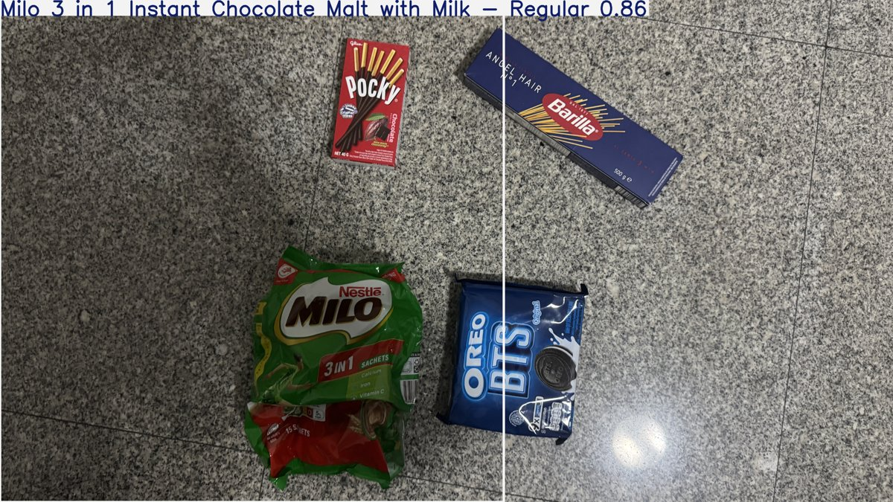
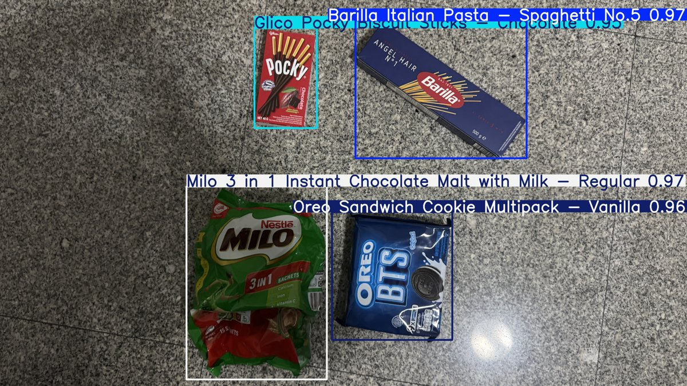

# Grocery Delivery Checker

Checks a grocery delivery against its e-receipt. A YOLO11s model detects the products, and a Gradio app crosses each one off the receipt and lists anything that was not delivered.

| First training run | Final model |
|---|---|
|  |  |

## How it works

1. **Product photos** (`download_images.ipynb`): photos of each product from several angles, with the backgrounds removed using rembg (BiRefNet) and the empty space cropped off.
2. **Synthetic dataset** (`generate_dataset.ipynb`): no labelled dataset existed, so this pastes 1 to 7 cut-out products onto real table surfaces at random sizes, angles and positions, adds soft shadows, and writes the YOLO labels. It makes 2,000 training images and 300 validation images.
3. **Training** (`train_model.ipynb`): fine-tunes YOLO11s for 50 epochs at 640 px.
4. **App** (`detection.ipynb`): load an e-receipt, then either hold items up to the webcam (live mode) or upload photos (photo mode). In live mode an item is crossed off once it has been detected steadily for 15 frames, and "Done" lists whatever is still missing.

## Results

Trained on store photos alone, the model found 2 of 34 items in real photos. Adding my own product photos, real table backgrounds, scaling and shadows to the synthetic data raised that to 33 of 34.

Products: Barilla Spaghetti No.5, Glico Pocky (Chocolate), Milo 3 in 1, Nutella, Oreo (Vanilla).

## Running it

```
pip install -r requirements.txt
```

Open `detection.ipynb` and run it. It loads the trained model from `weights/best.pt`, and `receipts/` has two sample e-receipts.

To retrain, put product photos in `Training Data/<product name>/` and background photos in `Backgrounds/` (neither is included), then run `generate_dataset.ipynb` and `train_model.ipynb`.
